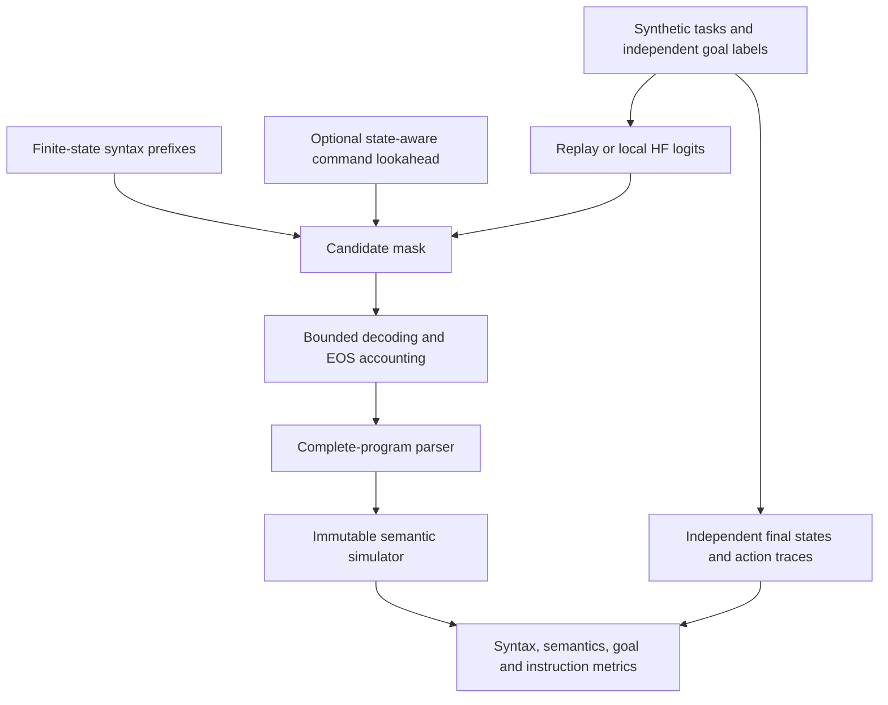
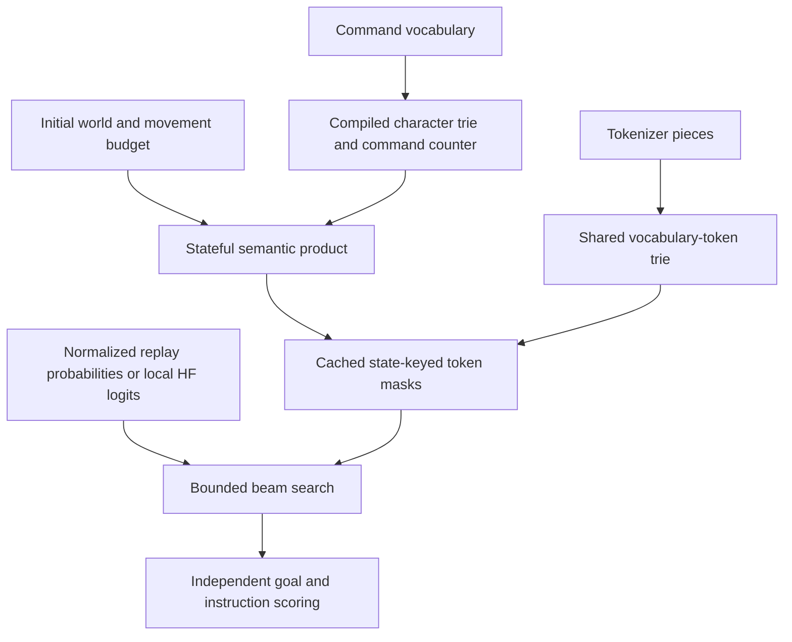

# Language recognition and robot state

## Syntax recognizer

`Grammar.status` tracks finite command prefixes and a bounded command-count register. After eight commands only `STOP` is available. `accepts` distinguishes complete programs from incomplete legal prefixes. The parser accepts only complete canonical programs; it exposes no arbitrary code, paths or dynamic operations.

## Semantic prefix mask

`SemanticGrammar` first validates syntax, then executes completed commands against the provided initial state. For an unfinished command, it tests finite matching command terminals for executability. This lookahead eliminates dead-end partial choices such as committing to a three-cell move that must leave the grid. It tracks total movement and ownership. It never receives expected output or desired goal. Accepting a prefix means a valid semantic continuation exists, not that the task has been solved.

Execution works on copied collections and returns a frozen state. Failures cannot mutate inputs. State containers, names, coordinates and budgets are validated. The movement budget is six cells by default, independent of the eight-command syntax budget.

## Independent scoring

Task construction labels final states directly from task parameters without running the interpreter. Golden execution is checked against those labels before scoring predictions. Final-state success and action-aware instruction success are separate: a skipped PICK/DROP pair may produce the same state but fails instruction success. Canonical action traces permit semantically equivalent movement partitioning.

## Decoding adapters

The replay decoder uses one character per token and a finite candidate trie with deliberate faults. All modes receive identical rankings, including an explicit golden fallback, so replay results are controlled mechanism evidence, not learned probabilities or model accuracy. Finite output budgets can leave every constrained mode incomplete.

The optional HF adapter decodes complete suffixes to handle tokens spanning terminals. Vocabulary enumeration uses actual token IDs, supports sparse IDs, ignores special tokens except final EOS, and intersects IDs with model output vocabulary bounds. It rejects non-progressing or non-prefix-preserving token decodes. Some tokenizer schemes remain incompatible with this ASCII DSL and fail explicitly. The exhaustive mask is a correctness baseline, not an optimized grammar compiler.

Fresh generation settings and disabling model defaults where supported prevent checkpoint forced tokens, minimum lengths, beams or suppressions from modifying the advertised greedy experiment. The strictest real model/tokenizer context limit applies. HF timing is measured around generation, synchronized on CUDA when used; no GPU timing has been measured here.

## Verified scope

Stdlib tests cover syntactic boundaries, semantic prefix viability, ownership/movement transitions, independent goal corruption, skipped actions, sparse token IDs and EOS behavior. An opt-in test builds a random tiny checkpoint to reproduce inherited forced-EOS masking failure and verify the correction. It establishes integration correctness for that checkpoint/tokenizer combination only. Pretrained-model task accuracy and optimized decoding performance remain unmeasured.

## Compiled search path

`compiled.py` owns incremental transition state and the search objective. `beam_hf.py` supplies actual local-model logits; unsupported tokenizer decoders explicitly use the existing slow reference mask. The compiler never receives goal labels. [automata-and-search.md](automata-and-search.md) specifies scoring, termination bounds, complexity and compatibility limits.
